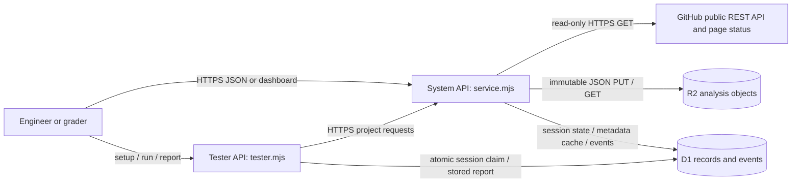
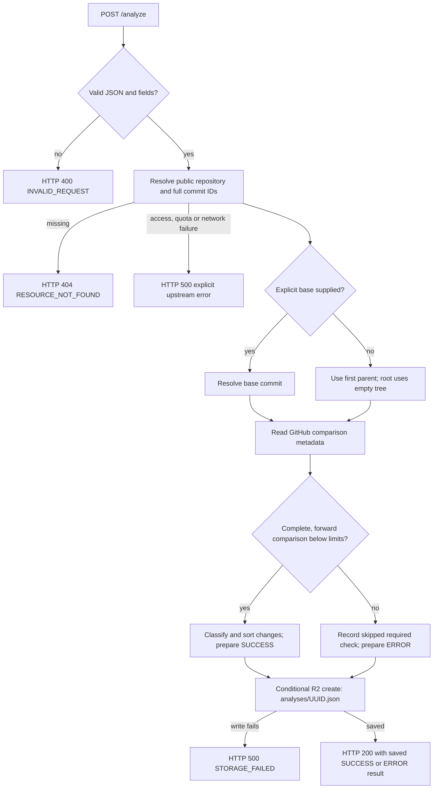
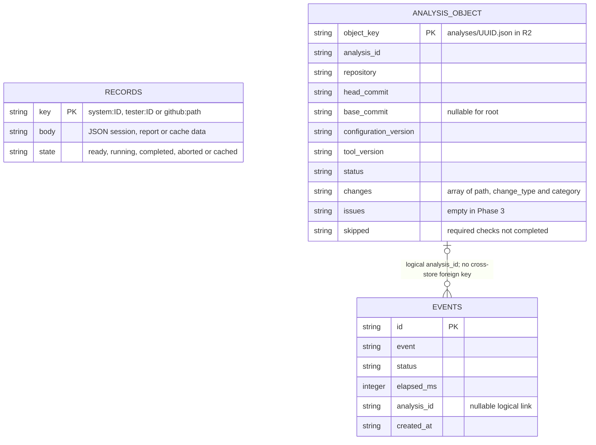

# Delivered system models

These diagrams describe the Phase 3 implementation. Planned documentation detectors, authorized review and GitHub comment delivery are excluded because they do not run yet. The original Phase 2 diagram images were not supplied; the comparison is against its written model and architecture descriptions.

## M1. System context and component/data-flow model

Supports REQ-01, REQ-04, REQ-05, REQ-06 and REQ-07. Changed: yes. The proposed FastAPI container and evidence repository were replaced by a Vinext Worker, D1 and R2. Each arrow identifies an implemented interface or data exchange.

The dashboard is `app/page.tsx`. `app/[...path]/route.ts` delegates to `src/service.mjs`; `src/analysis.mjs` resolves versions, classifies changes and persists evidence. The system and tester are independently addressable on the same deployed Worker, under `/system` and `/tester`. They share storage infrastructure, while the tester owns its HTTP sequence and assertions.

## M2. Analysis activity and failure model

Supports REQ-01, REQ-04, REQ-05 and REQ-07. Changed: yes. All storage failures are explicit; an incomplete required comparison produces a saved ERROR result, not SUCCESS.

Identical commits produce an empty change list. Root commits use the commit's changed-file list. Renames become DELETED old-path plus ADDED new-path; copied files become ADDED. Public-page status is used only to establish repository visibility or missing resources when the REST API is denied; a page's existence never substitutes for unavailable commit comparison metadata.

## M3. Information / persistence model

Supports REQ-04, REQ-05 and REQ-07. Changed: yes. The physical D1 schema contains two tables; immutable result JSON lives in R2, not D1.

Invariants: a completed project response is returned only after its JSON object is written; no API updates/deletes an analysis object; each analysis receives a UUID; subsequent runs create new objects. Session IDs use a unique primary key and tester runs use a conditional SQL transition, preventing two requests from consuming the same ready session. Report lookup returns the stored report without running project operations.

## M4. Tester session state machine

Supports REQ-05 and REQ-07 and the course-wide tester contract. Changed: yes; this required interface was absent from the two-operation Phase 2 prose.

```mermaid
stateDiagram-v2
  [*] --> Preparing: POST tester setup; generate UUID
  Preparing --> Ready: target setup returns 201 and identical ID
  Preparing --> [*]: failure forwarded; no runnable session
  Ready --> Running: one atomic SQL claim
  Running --> Completed: store complete suite report
  Running --> Aborted: store available outcomes and skips
  Completed --> Completed: GET report; later run returns 409
  Aborted --> Aborted: GET report; later run returns 409
```

Ready/running report requests return 409; unknown sessions return 404. Invalid run requests are rejected before the atomic claim and do not consume the session. The stored report contains every planned test exactly once, including after an internal abort. An instance crash can leave a running session without a final report; recovery/lease expiry is a disclosed limitation.
